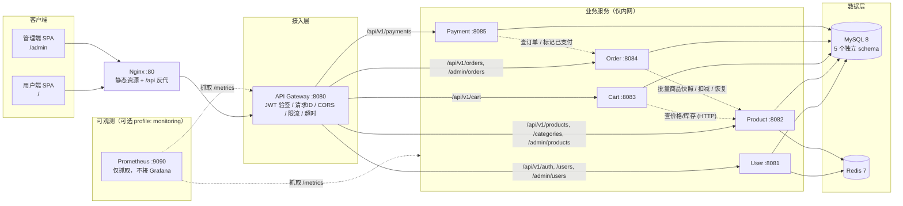
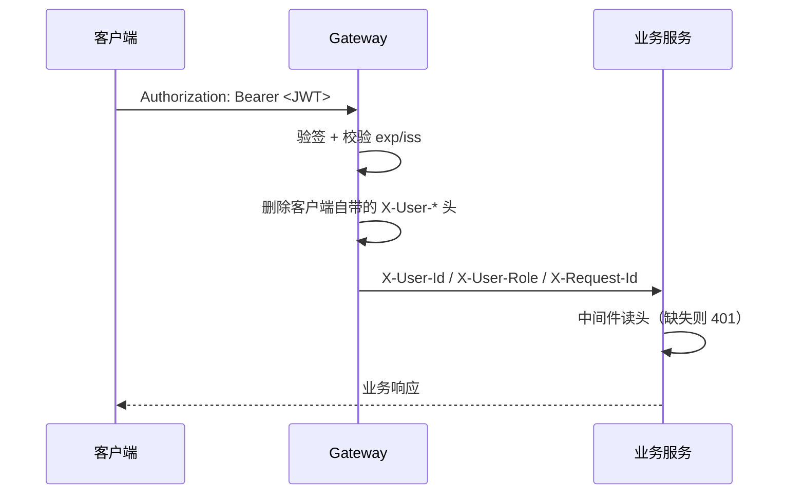
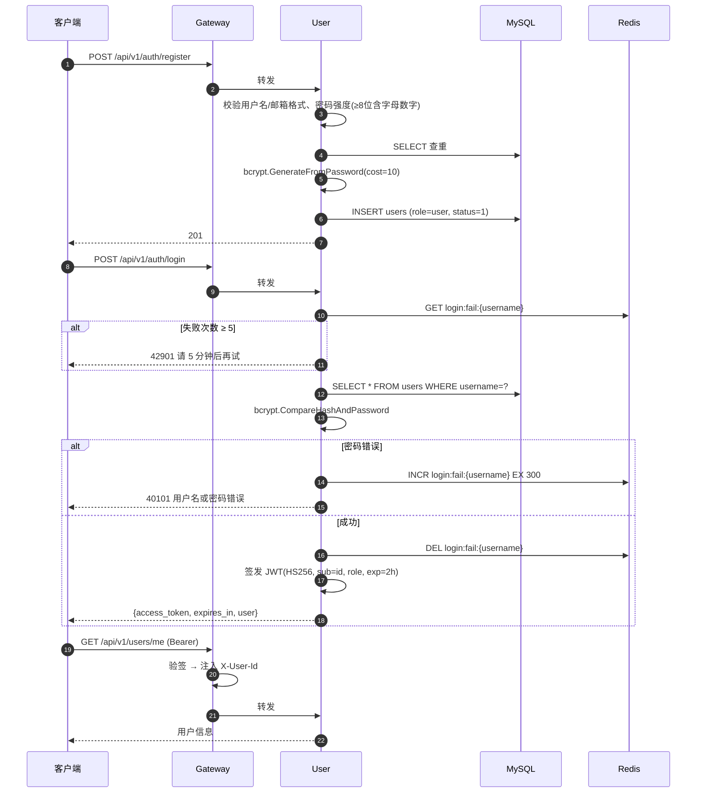
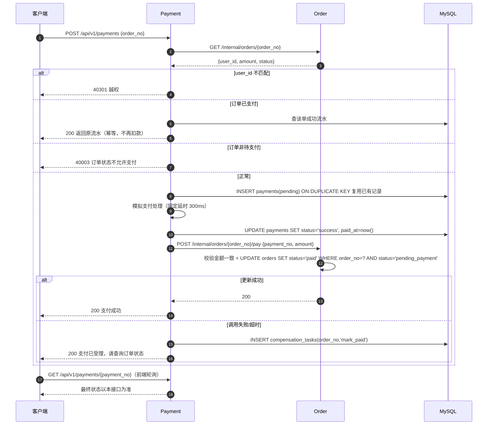

# go-mall 架构设计（阶段一）

> 版本：v0.1 ｜ 状态：待评审 ｜ 目标读者：开发者 / 学习者

> **注意：这是一份早期设计稿，实际实现做了大幅简化。**
>
> | 设计稿里写的 | 实际实现 |
> |---|---|
> | 7 个服务（含 payment、admin） | 5 个：gateway + user / product / cart / order |
> | 独立的 payment 服务、支付流水表、补偿重试 | 支付合进订单服务：`POST /orders/:no/pay` 直接改状态 |
> | Admin 独立服务 | 管理端接口挂在各业务服务的 `/admin/**` 下 |
> | Vue 3 + TypeScript + Element Plus | 原生 HTML + CSS + JS，`go:embed` 打进网关 |
> | Redis、Grafana、容器化部署 | 本地直跑，`REDIS_ENABLED=false`，不接 Grafana |
> | 订单状态 `pending_payment` | 简化为 `pending` / `paid` / `cancelled` |
>
> 文档里的服务拆分思路、库存扣减方案、错误码设计仍然有效，可以作为后续扩展的参考。
> 以 `README.md` 和实际代码为准。

---

## 0. 环境基线

| 组件 | 版本 | 说明 |
|---|---|---|
| Go | 1.26.3 | 已安装（本机为 windows/386，容器内构建 linux/amd64） |
| Docker | 29.4.1 | 已安装 |
| Docker Compose | v5.1.3 | 已安装 |
| Node.js | 22.21.1 | 前端构建 |
| MySQL | 8.0.43 | 本机已装，同时提供容器版 |

---

## 1. 整体架构



**部署视图**：单机 Docker Compose，一个自定义 bridge 网络 `mall-net`。只有 `nginx`（80）对外暴露端口，业务服务端口仅在网络内可达（本地调试时用 `ports` 映射到 127.0.0.1）。

**本项目不接入 Grafana**：指标通过各服务 `/metrics` 暴露，Prometheus 以可选 profile 启动（`docker compose --profile monitoring up -d`），只用于确认指标可用；不引入任何额外的可视化容器。

---

## 2. 服务职责与边界

| 服务 | 端口 | 拥有的数据 | 核心职责 | 明确不做 |
|---|---|---|---|---|
| Gateway | 8080 | 无 | 路由转发、JWT 验签、注入 `X-User-Id/X-User-Role/X-Request-Id`、CORS、统一错误响应、超时、基础限流 | 不查库、不做业务判断、不聚合业务数据 |
| User | 8081 | `users` | 注册、登录、签发 JWT、用户信息、角色/状态管理 | 不管地址簿、不管积分（本期不做） |
| Product | 8082 | `categories`、`products`、`stock_deductions` | 分类/商品 CRUD、搜索分页、上下架、**库存唯一真相源**、扣减/恢复 | 不知道订单存在，只认 `order_no` 作为幂等键 |
| Cart | 8083 | `carts`、`cart_items` | 购物车增删改查、实时金额试算 | **不存价格**，不锁库存，不创建订单 |
| Order | 8084 | `orders`、`order_items`、`compensation_tasks` | 下单、订单状态机、取消、快照落库、库存补偿 | 不直接读写商品表，不处理支付渠道 |
| Payment | 8085 | `payments` | 模拟支付、流水记录、重复支付拦截 | 不扣库存、不改订单表（只调 Order 的内部接口） |

### 2.1 关键取舍一：取消独立的 Admin Service（推荐）

原始需求列了 7 个服务。**Admin 不是一个业务域，它只是"角色 + 前端页面"**：

- 它没有自己的数据表，所有操作都是对 users/products/orders 的转发；
- 单独部署会变成纯代理层，多一跳、多一份鉴权逻辑、多一个故障点；
- 管理端接口天然属于各自资源：`/api/v1/admin/products` 归 Product，`/api/v1/admin/orders` 归 Order。

**方案**：不建 admin 服务。管理端 API 以 `/api/v1/admin/**` 前缀分布在各业务服务内，网关按第二段路径路由；前端做 `/admin` 路由分区 + 角色守卫；后端用 `RequireRole("admin")` 中间件强校验。

> 若你坚持要 7 个服务，我可以把 admin 做成一个只做 BFF 聚合的薄服务，但要接受"多一跳 + 逻辑重复"的代价。**推荐前者。**

### 2.2 关键取舍二：保留 Cart Service

购物车是 5 个服务里最薄的一个，可以合进 User。但保留它有三个实打实的理由：

1. 它有**独立数据**（`carts`/`cart_items`），生命周期和用户资料不同；
2. 它是"读多写多"的热点，独立后可单独扩容/加缓存；
3. 它能干净地演示"服务间只读调用"（向 Product 要价格），是很好的教学样本。

**结论**：保留，但在文档里明确标注"可合并服务"。

### 2.3 关键取舍三：订单不依赖购物车

下单接口接收 `items[{product_id, quantity}]`，不读购物车表。好处：

- 支持"立即购买"，不必先加购物车；
- Order 不需要调用 Cart，少一条服务依赖；
- 购物车清空由前端在下单成功后调用 `DELETE /api/v1/cart`，失败也不影响订单正确性。

---

## 3. API 前缀与通信关系

### 3.1 对外 API（经网关）

| 前缀 | 归属服务 | 鉴权 |
|---|---|---|
| `/api/v1/auth/**` | User | 公开（登录/注册），其余需 JWT |
| `/api/v1/users/**` | User | JWT |
| `/api/v1/products/**`、`/api/v1/categories/**` | Product | 公开读 |
| `/api/v1/cart/**` | Cart | JWT |
| `/api/v1/orders/**` | Order | JWT |
| `/api/v1/payments/**` | Payment | JWT |
| `/api/v1/admin/users/**` | User | JWT + admin |
| `/api/v1/admin/products/**`、`/api/v1/admin/categories/**` | Product | JWT + admin |
| `/api/v1/admin/orders/**` | Order | JWT + admin |
| `/api/v1/admin/stats/**` | Order / User / Product 各出一份 | JWT + admin |

### 3.2 内部 API（不过网关，仅内网，需 `X-Internal-Token`）

| 方法 | 路径 | 提供方 | 调用方 | 用途 |
|---|---|---|---|---|
| POST | `/internal/products/batch` | Product | Cart / Order | 按 ID 批量取商品快照（名称、价格、状态、库存） |
| POST | `/internal/products/stock/deduct` | Product | Order | 幂等扣减库存（key=`order_no`） |
| POST | `/internal/products/stock/restore` | Product | Order | 幂等恢复库存（key=`order_no`） |
| GET | `/internal/orders/{order_no}` | Order | Payment | 查订单金额与状态 |
| POST | `/internal/orders/{order_no}/pay` | Order | Payment | 标记已支付（幂等，带 `payment_no`） |
| GET | `/internal/users/{id}` | User | Order（管理端展示） | 取用户名（脱敏） |

### 3.3 鉴权信息如何传递



- **网关负责验签并注入身份头**，业务服务优先读取 `X-User-Id / X-User-Role`；
- **兜底**：当身份头缺失时（本地直连、服务独立调试），服务自己校验 `Authorization: Bearer <JWT>`。两条路径共用 `pkg/middleware.Auth`，业务代码无感知；
- 业务服务端口不对宿主机暴露（Compose 内网），内部接口额外校验 `X-Internal-Token`；
- **风险已知**：内网被攻破即可伪造身份头。生产建议 mTLS 或只保留自验签路径，本期接受该取舍并在此标注。

### 3.4 统一响应与错误码

```json
{ "code": 0, "message": "success", "data": {} }
{ "code": 40002, "message": "库存不足", "data": null, "request_id": "..." }
```

| code | HTTP | 含义 |
|---|---|---|
| 0 | 200/201 | 成功 |
| 40001 | 400 | 参数校验失败 |
| 40101 | 401 | 未登录 / Token 无效过期 |
| 40301 | 403 | 无权限（含越权访问他人资源） |
| 40401 | 404 | 资源不存在 |
| 40901 | 409 | 状态冲突（重复提交、重复支付） |
| 40002 | 409 | 库存不足 |
| 40003 | 409 | 订单状态不允许该操作 |
| 42901 | 429 | 触发限流 |
| 50001 | 500 | 服务内部错误 |
| 50301 | 503 | 依赖服务不可用 |

金额在 API 中统一用**字符串**表示元，如 `"129.90"`；服务内部用 `int64` 分运算。

### 3.5 API 清单

**User**

| 方法 | 路径 | 说明 | 鉴权 |
|---|---|---|---|
| POST | `/api/v1/auth/register` | 注册 | 公开 |
| POST | `/api/v1/auth/login` | 登录，返回 access_token | 公开 |
| POST | `/api/v1/auth/logout` | 登出（Redis 黑名单） | JWT |
| GET | `/api/v1/users/me` | 当前用户 | JWT |
| PUT | `/api/v1/users/me` | 改昵称/邮箱 | JWT |
| PUT | `/api/v1/users/me/password` | 改密码 | JWT |
| GET | `/api/v1/admin/users` | 用户分页查询 | admin |
| PUT | `/api/v1/admin/users/{id}/status` | 启用/禁用 | admin |
| PUT | `/api/v1/admin/users/{id}/role` | 改角色 | admin |

**Product**

| 方法 | 路径 | 说明 | 鉴权 |
|---|---|---|---|
| GET | `/api/v1/categories` | 分类列表 | 公开 |
| GET | `/api/v1/products` | 列表：`page` `page_size` `keyword` `category_id` `min_price` `max_price` `sort` | 公开 |
| GET | `/api/v1/products/{id}` | 详情 | 公开 |
| POST | `/api/v1/admin/categories` | 建分类 | admin |
| PUT | `/api/v1/admin/categories/{id}` | 改分类 | admin |
| DELETE | `/api/v1/admin/categories/{id}` | 删分类（有商品则拒绝） | admin |
| GET | `/api/v1/admin/products` | 含下架商品的分页 | admin |
| POST | `/api/v1/admin/products` | 建商品 | admin |
| PUT | `/api/v1/admin/products/{id}` | 改商品 | admin |
| DELETE | `/api/v1/admin/products/{id}` | 删商品（有订单引用则改为下架） | admin |
| PUT | `/api/v1/admin/products/{id}/status` | 上/下架 | admin |

**Cart**

| 方法 | 路径 | 说明 | 鉴权 |
|---|---|---|---|
| GET | `/api/v1/cart` | 购物车（含实时价格与合计） | JWT |
| POST | `/api/v1/cart/items` | 加购 `{product_id, quantity}` | JWT |
| PUT | `/api/v1/cart/items/{product_id}` | 改数量 | JWT |
| DELETE | `/api/v1/cart/items/{product_id}` | 删除一项 | JWT |
| DELETE | `/api/v1/cart` | 清空 | JWT |

**Order**

| 方法 | 路径 | 说明 | 鉴权 |
|---|---|---|---|
| POST | `/api/v1/orders` | 下单，需 `Idempotency-Key` 头 | JWT |
| GET | `/api/v1/orders` | 我的订单 `status` `page` | JWT |
| GET | `/api/v1/orders/{order_no}` | 详情（含明细） | JWT |
| POST | `/api/v1/orders/{order_no}/cancel` | 取消待支付订单 | JWT |
| GET | `/api/v1/admin/orders` | 全部订单 | admin |
| PUT | `/api/v1/admin/orders/{order_no}/status` | 改状态（仅允许白名单转换） | admin |
| GET | `/api/v1/admin/stats/orders` | 订单数/销售额/待支付数 | admin |

**Payment**

| 方法 | 路径 | 说明 | 鉴权 |
|---|---|---|---|
| POST | `/api/v1/payments` | 发起模拟支付 `{order_no}` | JWT |
| GET | `/api/v1/payments/{payment_no}` | 查询支付状态 | JWT |
| POST | `/api/v1/payments/{payment_no}/mock-result` | 模拟支付失败（演示用） | JWT |

**通用**：`/healthz`（进程存活）、`/readyz`（MySQL/Redis 可达）、`/metrics`。

---

## 4. 数据库设计初稿

### 4.1 数据归属（单实例、多 schema）

| schema | 归属服务 | 表 |
|---|---|---|
| `mall_user` | User | `users` |
| `mall_product` | Product | `categories`、`products`、`stock_deductions` |
| `mall_cart` | Cart | `carts`、`cart_items` |
| `mall_order` | Order | `orders`、`order_items`、`compensation_tasks` |
| `mall_payment` | Payment | `payments` |

每个 schema 配独立账号，只授权自己的库 —— 用**权限**而不是"自觉"来保证边界。

### 4.2 表结构（关键字段与索引）

**users**
```
id BIGINT UNSIGNED PK AUTO_INCREMENT
username VARCHAR(32)  NOT NULL, UNIQUE uk_username
email    VARCHAR(128) NOT NULL, UNIQUE uk_email
password_hash VARCHAR(72) NOT NULL      -- bcrypt 60 字符
nickname VARCHAR(32)
role   VARCHAR(16) NOT NULL DEFAULT 'user'   -- user | admin
status TINYINT NOT NULL DEFAULT 1            -- 1 正常 0 禁用
created_at / updated_at DATETIME(3)
```

**categories**
```
id, name VARCHAR(64) UNIQUE uk_name, sort INT, created_at, updated_at
```

**products**
```
id, category_id BIGINT UNSIGNED NOT NULL
name VARCHAR(128) NOT NULL
description TEXT
price DECIMAL(10,2) NOT NULL            -- 精确金额
stock INT NOT NULL DEFAULT 0
image_url VARCHAR(255)
status TINYINT NOT NULL DEFAULT 1       -- 1 上架 0 下架
created_at / updated_at
INDEX idx_category_status (category_id, status)
INDEX idx_status_created (status, created_at)
INDEX idx_name (name)                   -- 前缀匹配用；模糊搜索走 LIKE，数据量大再上 FULLTEXT
```

**stock_deductions**（内部幂等账本，非业务展示）
```
id, order_no VARCHAR(32) NOT NULL, product_id BIGINT UNSIGNED, quantity INT
status VARCHAR(16)  -- deducted | restored
created_at, updated_at
UNIQUE uk_order_product (order_no, product_id)
```

**carts / cart_items**
```
carts:      id, user_id UNIQUE uk_user, created_at, updated_at
cart_items: id, cart_id, product_id, quantity INT
            UNIQUE uk_cart_product (cart_id, product_id)
            INDEX idx_cart (cart_id)
-- 不存价格：价格永远从 Product 服务实时取
```

**orders**
```
id, order_no VARCHAR(32) NOT NULL UNIQUE uk_order_no
user_id BIGINT UNSIGNED NOT NULL
total_amount DECIMAL(10,2) NOT NULL
status VARCHAR(20) NOT NULL     -- pending_payment | paid | cancelled
idempotency_key VARCHAR(64) NOT NULL
paid_at / cancelled_at DATETIME(3) NULL
created_at / updated_at
UNIQUE uk_user_idem (user_id, idempotency_key)
INDEX idx_user_created (user_id, created_at)
INDEX idx_status_created (status, created_at)
```

**order_items**（历史快照，商品改名改价不影响）
```
id, order_id, product_id
product_name VARCHAR(128)   -- 快照
product_image VARCHAR(255)  -- 快照
unit_price DECIMAL(10,2)    -- 成交单价快照
quantity INT, subtotal DECIMAL(10,2)
INDEX idx_order (order_id)
```

**payments**
```
id, payment_no VARCHAR(32) UNIQUE uk_payment_no
order_no VARCHAR(32) NOT NULL UNIQUE uk_order   -- 一单一条支付记录，失败复用同一条
user_id, amount DECIMAL(10,2)
status VARCHAR(16)   -- pending | success | failed
channel VARCHAR(16) DEFAULT 'mock'
paid_at, created_at, updated_at
INDEX idx_status_created (status, created_at)
```

**compensation_tasks**（补偿队列，替代 MQ）
```
id, order_no, action VARCHAR(32)  -- restore_stock | mark_paid
status VARCHAR(16)                -- pending | done | failed
retry_count INT, next_retry_at DATETIME(3), last_error VARCHAR(255)
UNIQUE uk_order_action (order_no, action)
INDEX idx_status_next (status, next_retry_at)
```

### 4.3 外键策略

- **同库内**（`order_items → orders`、`cart_items → carts`）：**使用外键**，成本低、能挡住脏数据；
- **跨库**（`cart_items.product_id → products.id`）：**不用外键**，物理上做不到，由应用层校验；
- 商品删除策略：有订单引用则**逻辑下架**而非物理删除（`order_items` 存快照，但避免悬空引用）。

### 4.4 金额策略

DB 用 `DECIMAL(10,2)`，Go 用 `int64` 分（`type Money int64`），API 用字符串 `"129.90"`。
三层在 repository 边界统一转换，**任何层都不出现 float64**。

---

## 5. 核心业务流程

### 5.1 注册与登录



### 5.2 购物车 → 下单（含并发扣库存）

```mermaid
sequenceDiagram
    autonumber
    participant C as 客户端
    participant G as Gateway
    participant CS as Cart
    participant PS as Product
    participant OS as Order
    participant DB as MySQL(order)

    C->>G: GET /api/v1/cart
    G->>CS: 转发
    CS->>PS: POST /internal/products/batch {ids}
    PS-->>CS: [{id,name,price,stock,status}]
    CS-->>C: 明细 + 实时合计（价格以 Product 为准）

    C->>G: POST /api/v1/orders (Idempotency-Key: uuid)
    G->>OS: 转发 + X-User-Id
    OS->>DB: 查 uk_user_idem 是否已存在
    alt 已存在
        OS-->>C: 200 返回原订单（幂等）
    end
    OS->>OS: 校验数量 >0、商品数 ≤ 50
    OS->>PS: POST /internal/products/stock/deduct {order_no, items[]}
    PS->>PS: 事务内逐条 UPDATE products SET stock=stock-? WHERE id=? AND status=1 AND stock>=?
    alt 任一条影响行数=0
        PS->>PS: ROLLBACK
        PS-->>OS: 40002 库存不足
        OS-->>C: 40002（未产生订单）
    else 全部成功
        PS->>PS: INSERT stock_deductions(order_no, product_id, qty, 'deducted')
        PS-->>OS: 200 + 商品快照（含服务端价格）
        OS->>DB: BEGIN; INSERT orders + order_items; COMMIT
        alt 落库失败
            OS->>PS: POST /internal/products/stock/restore（重试 3 次，退避 200/500/1000ms）
            alt 补偿仍失败
                OS->>DB: INSERT compensation_tasks(order_no,'restore_stock')
            end
            OS-->>C: 50001
        else 成功
            OS-->>C: 201 {order_no, total_amount, status}
        end
    end
```

**为什么先扣库存、后落订单**：库存是稀缺资源，必须尽早用数据库原子操作锁住，否则两个请求都通过校验再各自落单就会超卖。代价是"扣了但单没成"的窗口，用补偿表兜底。

**为什么用 `UPDATE ... WHERE stock >= ?`**：单条 SQL 在 InnoDB 行锁下天然原子，`affected_rows == 0` 即库存不足；比"先 SELECT 再 UPDATE"少一次竞态。

### 5.3 支付



**一致性说明**：前端点击"支付成功"**不等于**订单已支付。支付服务写成功流水后必须同步通知订单服务；通知失败进补偿队列，30s 后重试，直到订单状态更新。前端只认 `GET /payments/{no}` 与 `GET /orders/{no}` 的结果。

### 5.4 取消订单

```mermaid
sequenceDiagram
    autonumber
    participant C as 客户端
    participant OS as Order
    participant PS as Product

    C->>OS: POST /api/v1/orders/{order_no}/cancel
    OS->>OS: UPDATE orders SET status='cancelled' WHERE order_no=? AND user_id=? AND status='pending_payment'
    alt 影响行数=0
        OS-->>C: 40003 订单不存在或状态不允许取消
    else 影响行数=1（状态机保证只执行一次）
        OS->>PS: POST /internal/products/stock/restore {order_no}
        PS->>PS: SELECT stock_deductions WHERE order_no=? FOR UPDATE
        alt 已是 restored
            PS-->>OS: 200（幂等，不重复加库存）
        else
            PS->>PS: 事务内 UPDATE products SET stock=stock+? ; UPDATE stock_deductions SET status='restored'
            PS-->>OS: 200
        end
        alt 恢复失败
            OS->>OS: INSERT compensation_tasks(order_no,'restore_stock')
        end
        OS-->>C: 200 已取消
    end
```

---

## 6. 技术选型理由与风险

| 选择 | 理由 | 风险 / 对策 |
|---|---|---|
| **Gin** | 生态成熟、中间件模型清晰、`c.ShouldBindJSON` + validator 一体化 | 版本锁定 `v1.10.x`；不追求极致性能 |
| **GORM v2** | 学习曲线低，`Where` 条件化查询方便 | 隐式事务、软删除易踩坑 → 显式 `db.Transaction`，不用软删除 |
| **MySQL 8** | 事务 + 行锁，是库存扣减的正确工具 | 需注意隔离级别与索引；扣减必须走单条 UPDATE |
| **Redis 7** | 登录限流 + 商品详情缓存，两处都有明确收益 | 缓存一致性 → 更新商品时删 key，TTL 60s 兜底 |
| **JWT（HS256）** | 无状态、跨服务传递方便 | 无法主动失效 → 登出写 Redis 黑名单（TTL=剩余有效期） |
| **网关自研（Gin）** | 路由表、JWT、请求 ID、统一错误都在掌握中，教学价值高 | 功能不如 Kong/Traefik → 明确"仅基础能力"，不承诺限流熔断全套 |
| **同步 HTTP + 补偿表** | 不引入 MQ 也能讲清一致性，本地一条命令起得来 | 补偿有延迟 → 补偿任务 30s 轮询，前端轮询订单状态 |
| **单实例多 schema** | 边界清晰、启动简单、可平滑拆库 | 单点故障 → 生产需主从；本期文档标注 |
| **自研迁移器（embed + schema_migrations）** | 30 行代码，无额外依赖，每服务启动自动迁移 | 无回滚能力 → 只写 forward 迁移，破坏性变更单独脚本 |
| **int64 分 + DECIMAL(10,2)** | 彻底避开浮点误差 | 转换点集中在 repository，需单测覆盖 |

### 主要风险登记

| # | 风险 | 影响 | 缓解 |
|---|---|---|---|
| R1 | 扣库存成功但订单落库失败 | 少卖 | 补偿表 + 定时重试 + 对账脚本 |
| R2 | 支付成功但订单未更新 | 用户看到"已付款未支付" | 补偿重试 + 前端轮询 + 管理端人工修正 |
| R3 | 网关信任内网头 | 内网被攻破可伪造身份 | 端口不暴露 + 内部 Token；生产上 mTLS/自验签 |
| R4 | 5 个服务调试成本高 | 学习曲线陡 | 提供 `make dev-up`、统一日志、每个服务可独立 `go run` |
| R5 | 模糊搜索 `LIKE '%x%'` 全表扫 | 数据量大变慢 | 本期数据量小可接受；文档给出 FULLTEXT / ES 演进路径 |
| R6 | 单 MySQL 实例 | 无高可用 | 明确标注为基础版限制 |
| R7 | 端口冲突（9090 Prometheus 与常见本地工具） | 启动失败 | 全部端口可通过 `.env` 覆盖 |

---

## 7. 阶段一验收标准

- [ ] 架构图与实际服务数量、端口、依赖方向一致
- [ ] 每个服务的数据归属唯一，无跨服务直接读写他人表
- [ ] 服务间调用关系闭合（无循环依赖：Cart→Product，Order→Product，Payment→Order）
- [ ] 8 张核心表 + 2 张辅助表字段、唯一约束、索引齐全，金额无 float
- [ ] 订单快照字段（名称、单价、图片）明确
- [ ] 下单、支付、取消三条链路都有幂等键与补偿方案
- [ ] 权限矩阵覆盖：公开 / 登录 / 管理员 / 资源属主四类
- [ ] 风险登记表至少覆盖一致性、安全、可运维三类
- [ ] 已确认"取消 Admin 独立服务"的取舍

---

## 8. 后续开发计划

| 阶段 | 交付物 | 验证方式 |
|---|---|---|
| 二 | 目录骨架、`pkg/`（config/logger/response/errors/middleware/metrics）、Compose 起 MySQL+Redis | `docker compose up -d mysql redis` 后 `make health` 通过 |
| 三 | User 服务（注册/登录/JWT/权限）+ 迁移脚本 | `go test ./services/user/...`，curl 跑通注册登录 |
| 四 | Product 服务（分类/商品/搜索/上下架/库存扣减） | 单测 + 并发扣减测试（100 goroutine 买 10 件只成功 10） |
| 五 | Cart 服务 | 单测 + 跨用户越权测试 |
| 六 | Order 服务（下单/取消/幂等/补偿） | 幂等测试、库存不足测试、取消恢复不重复测试 |
| 七 | Payment 服务（模拟支付/重复支付） | 重复支付只成功一次；支付后订单变 paid |
| 八 | Gateway（路由/JWT/CORS/请求ID/超时/错误） | 全链路 curl 脚本 |
| 九 | 前端（Vue3 + TS + Element Plus，用户端 + 管理端） | `npm run build` 通过，页面走通全流程 |
| 十 | 测试与质量（go test / go vet / 前端构建 / 集成脚本） | 全绿 |
| 十一 | Dockerfile × 6 + Compose 全量 + Nginx | `docker compose up -d --build` 后健康检查全 healthy |
| 十二 | Prometheus + 三份文档 + Swagger | `/metrics` 有数据，Prometheus targets 全 UP |
| 十三 | 验收清单逐项验证 + 故障排查指南 | 按清单打勾 |

---

## 9. 架构自检

**是否存在不必要的拆分？**
有。Admin Service 已合并（见 2.1）。Cart 保留但标注可合并。其余 5 个服务各有独立数据与独立生命周期，拆分成立。

**是否存在重复职责？**
- 鉴权：只在网关验签，业务服务只读头 → 不重复。
- 价格计算：Product 是唯一价格来源，Cart/Order 只做汇总 → 不重复。
- 库存：只有 Product 能改 → 不重复。

**数据一致性**
- 库存：单条条件 UPDATE + 幂等账本表；
- 订单：本地事务 + 快照；
- 支付：状态机条件更新 + 补偿队列；
- 全部有唯一约束兜底（`uk_user_idem`、`uk_order_product`、`uk_payment_no`）。

**安全**
- 密码 bcrypt；JWT 2h + 黑名单；RBAC 中间件；
- 所有查询强制 `user_id` 来自 token，杜绝改参数越权；
- 登录限流；CORS 白名单；日志脱敏（不打印 password/token）；
- 生产环境启动时校验 `JWT_SECRET` 非默认值，否则拒绝启动。

---

**下一步**：请确认 2.1 的取舍（Admin 是否合并）与 4.1 的"单实例多 schema"方案。确认后进入阶段二，创建项目骨架、配置中心、日志、统一响应与 Compose 基础环境。
